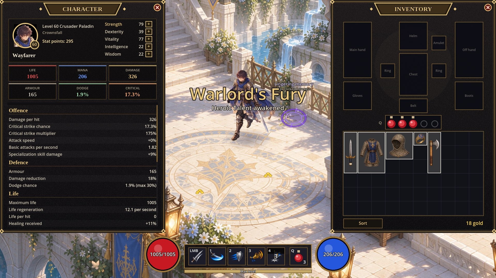

# Age of the Lost

A 2D isometric action RPG in the spirit of Diablo and Path of Exile, with painted
anime art inspired by Ragnarok Online and Octopath Traveler. Built in **Godot 4.3**
(GDScript), aimed at PC / Steam.



## What's here

| Folder | Contents |
| --- | --- |
| `crownfall/` | The Godot project. Open `crownfall/project.godot` in Godot 4.3. |
| `crownfall/HANDOFF.md` | Full design and code guide: systems, files, testing, how the art was made. Start here. |
| `tools/` | Art pipeline scripts (green-screen keying, attack strip builder). |
| `crownfall/tools/` | Sound effect and music generators. |
| `screenshots/` | Captures from the automated test run. |
| `Higgsfield_Trial_Shot_List.md` | Planned animation shots for the art pipeline. |
| `art/` | Artwork libraries (equipment, ability and UI art). Large files use Git LFS: run `git lfs pull`. |

## Controls

Click to move and attack · 1–4 skills · Q potion · C character · I inventory ·
K stash · P spellbook · J journal · E talk / Lorecast · R Reality Scar · Esc close.

## Testing

```
godot --path crownfall -- --autotest --shots=<folder>
```

Plays a scripted session and runs 110 checks (inventory, stash, merchant, stats,
Lorecasting, audio, save and load). See `crownfall/HANDOFF.md`.

## Item taxonomy artwork

[Open the equipment art library](art/item_taxonomy/2026-11-12/README.md): 61 reviewed equipment-art candidates, footprint-normalized transparent PNGs, original Higgsfield sources, an interactive Godot 4.6.3 review project, and a 13-page PDF catalog. Image/geometry checks: 366/366. The optional future arquebus remains unproduced. These are artwork candidates; no gameplay definitions or saves are changed.

Large PNG/PDF files use Git LFS. Install Git LFS, clone this repository, then run `git lfs pull` to obtain their full bytes. Open `art/item_taxonomy/2026-11-12/project.godot` in Godot to inspect the library.

Browser copies: [PDF catalog](https://drive.google.com/file/d/1I5bkj1iWO-0gS0JaL8PgqjYnxIL2YeCe/view) and [complete ZIP](https://drive.google.com/file/d/151THqMOpRRYznfoSqywVf2Mym-at-fO0/view).

## Artwork Expansion02

[Open Expansion02](art/expansion02/2026-11-12/README.md): 42 additional designs — 12 equipment variants, 19 implemented-ability icons and 11 service/interaction symbols. Includes512px UI masters and90 derived32/64/128px textures, a Godot readability viewer, CSV/JSON ID mapping, source provenance and a9-page visual catalog. Image checks:522/522. Seven new source sheets were generated with OpenAI image_gen; the preceding library retains its Higgsfield provenance.

Together the two libraries provide103 candidate designs. Derived sizes are excluded from that count. Gameplay integration remains a separate step.

[Editable Google Doc index](https://docs.google.com/document/d/131-JFsR6pRWZPwCLMi75Vi4ldUj6zDSxtOZa2LdvIo8) · [Expansion02 PDF](https://drive.google.com/file/d/1mc3FYLM_USKS2MwqEKsYn18zj6H-IRdF/view).
