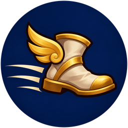

# Dodge Roll ability icon

A single UI icon for a "Dodge Roll" button: an ivory and gold boot in side view, toe pointing right, with a gold wing at the ankle and three speed lines trailing to the left, on a deep navy disc.

| File | Use |
| --- | --- |
| `dodge_roll_source_1024.png` | Exact Higgsfield output, 1024x1024 RGB, white corners outside the disc |
| `dodge_roll_1024.png` | Master with transparent corners (RGBA) |
| `dodge_roll_256.png`, `dodge_roll_128.png`, `dodge_roll_64.png`, `dodge_roll_48.png` | Runtime sizes, transparent corners |
| `dodge_roll.json` | Prompt, job ID, settings and SHA-256 of every file |

- Made with Higgsfield, model `gpt_image_2_6`, job `9e7c5fc8-a976-457a-85b6-eb1f6c04de19`, text prompt only (no reference images), 0 credits.
- Processing after generation: circular alpha mask and Lanczos downsampling only.
- These PNGs are stored as normal Git files (not Git LFS), so they can be read directly from the repository.

## Status

Artwork only. No Dodge Roll ability, input binding or game data was added, and nothing under `game/` was changed. This icon is a round, unframed design; the approved action-bar skill tiles in `art/skill_tiles/2026-11-12/` are square with beveled metal frames, so decide whether this one is used as-is (for example on a separate round dodge button) or re-framed to match before wiring it in.
