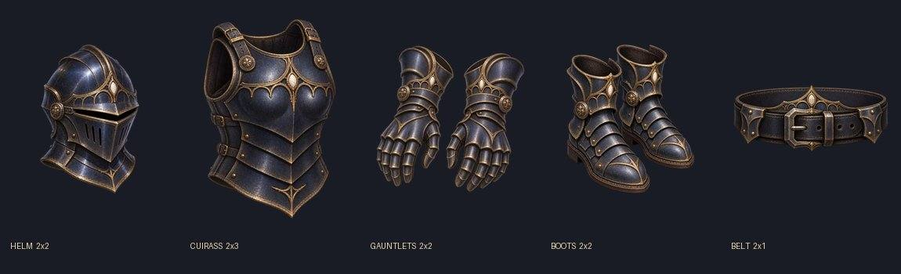

# Chronicle Guard — five-piece AOTL plate armor art set

Five original, matching **Chronicle Guard** collectible equipment illustrations created in **Higgsfield GPT Image 2.6** using the user's unlimited allowance. **Zero paid credits** spent.

| Piece | Grid (W×H) | Repo review texture |
|---|---:|---|
| Visored helmet | 2×2 | `runtime_items/aotl_chronicle_guard_helm_2x2_indexed.png` |
| Cuirass | 2×3 | `runtime_items/aotl_chronicle_guard_cuirass_2x3_indexed.png` |
| Pair of gauntlets | 2×2 | `runtime_items/aotl_chronicle_guard_gauntlets_2x2_indexed.png` |
| Pair of sabatons | 2×2 | `runtime_items/aotl_chronicle_guard_boots_2x2_indexed.png` |
| Warbelt | 2×1 | `runtime_items/aotl_chronicle_guard_belt_2x1_indexed.png` |

The original artwork is **real transparent RGBA** from Higgsfield, not background-keyed. Full-size source PNGs, full-quality 128-pixel-per-cell RGBA exports, compressed review sprites, the contact sheet, and provenance/hashes are preserved in the Higgsfield Developer Files archive with media ID `123e97ff-4835-4030-97bc-db39cc3bf518`. A link to each individual generated source is provided in `SOURCE_MANIFEST.json`.

The five compact indexed PNGs in this GitHub branch are additional small, fully transparent review-ready sprites. Their color reduction should be inspected against the full RGBA masters before accepting as shipping art. **No gameplay items have been added, no save schemas changed, and this branch must not automatically replace the existing art.**

### Review / integration procedure
1. Check original vs compact images at actual in-game grid size and on both dark inventory slots and light staging backgrounds.
2. Run `python validate_chronicle_guard.py` (Pillow required).
3. For approved pieces, copy full RGBA master PNGs (preferred) to a safe isolated Godot art-preview branch and use existing item-size data as authoritative.
4. Test both Warrior and Mage inventory, stash, merchant comparison, dragging, and save/load; treat as art variants rather than new gameplay item definitions.
5. Merge only after review and those regression checks.

This production branch is additive and compatible with the 61-item original taxonomy, optional Emberlock Arquebus art branch, and the separate Expansion02 asset pack.
