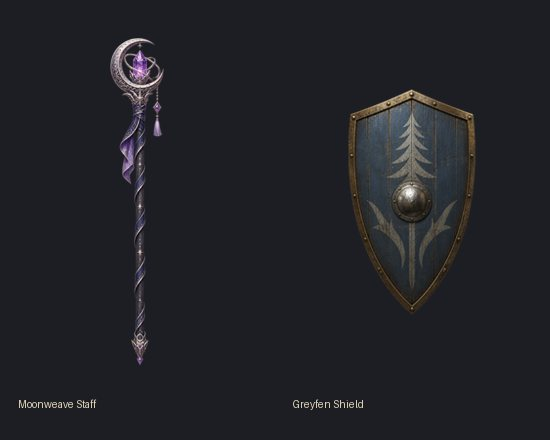

# AOTL companion weapons — Moonweave staff and Greyfen shield

This additive art-review folder extends the Phase A Moonweave Cloth and Greyfen Mail sets with two original Higgsfield weapon/offhand designs.

| Item | Item footprint | Model |
|---|---|---|
| Moonweave Chronicle Staff | 2 × 4 | Higgsfield GPT Image 2.6 |
| Greyfen Warden Shield | 2 × 2 | Higgsfield GPT Image 2 |

Both images generated with unlimited allowance; **paid credits spent 0**. The shield required an alternate Higgsfield model after two failed GPT Image 2.6 jobs; failed jobs were not counted.

GitHub provides compact transparent icon previews, provenance hashes and a static validator. Full original source PNGs, full-quality RGBA masters, a separate intermediate shield alpha cutout, and the contact sheet are stored in the **confirmed Higgsfield Developer Files archive** `06f73c59-712c-4ce4-8e36-6a2d57ee034d` (3,589,083 bytes, 10 files).

The Greyfen shield's opaque background was **automatically extracted with GrabCut**. It looks acceptable on a dark review board but needs special alpha-fringe assessment on a bright background, plus real inventory-size and Godot runtime checks.

These are review-only equipment variants. They do not change the equipment taxonomy, item stats, rarity, loot tables, game saves or validated baseline. No merge until visual acceptance and gameplay QA.
