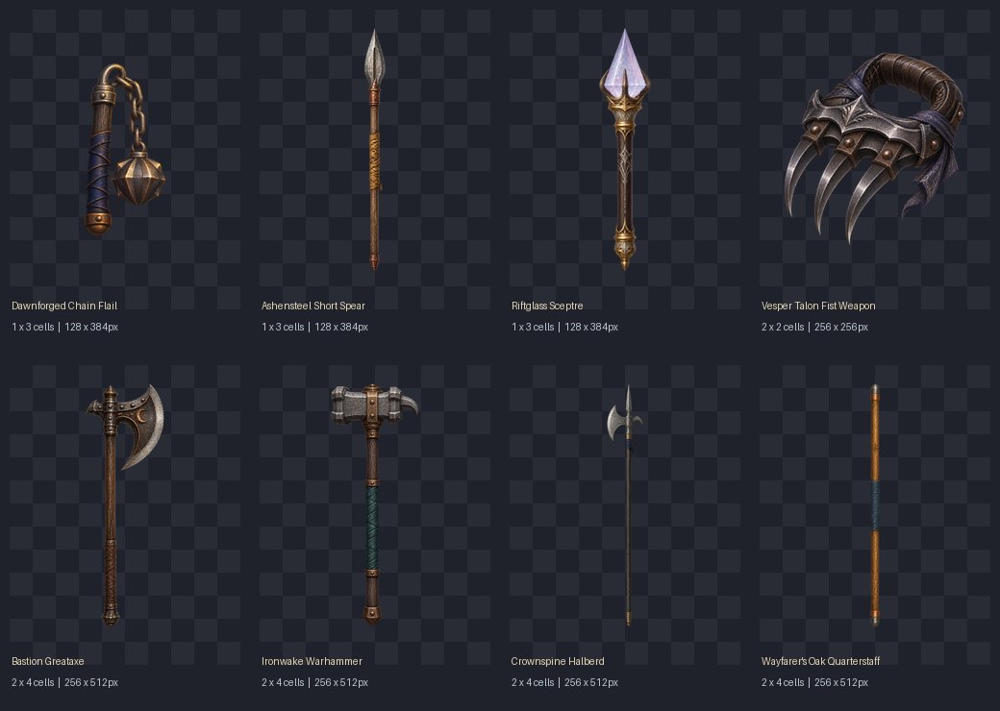
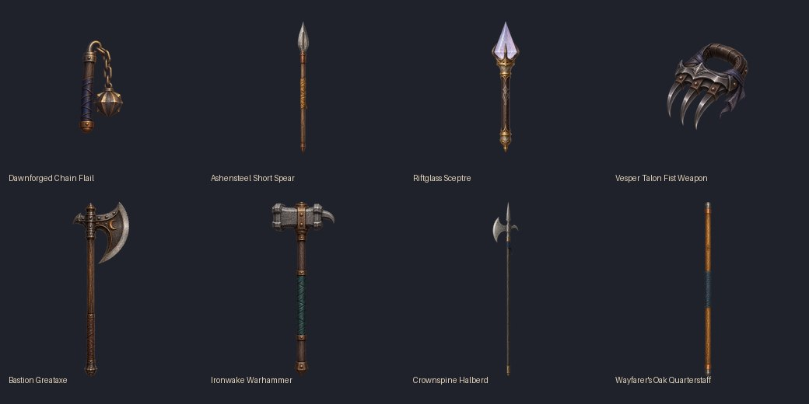

# Age of the Lost — Forged Weapons (eight original variants)

Eight original AOTL item illustrations made in **Higgsfield GPT Image 2.6** under **Ultra unlimited entitlement only**: **zero paid credits spent**. The existing equipment taxonomy already has a basic source-art candidate for each weapon family; these are **new named visual variants**, not previously missing item types.

| Name | Inventory grid (W×H) |
|---|---:|
| Dawnforged Chain Flail | 1×3 |
| Ashensteel Short Spear | 1×3 |
| Riftglass Sceptre | 1×3 |
| Vesper Talon Fist Weapon | 2×2 |
| Bastion Greataxe | 2×4 |
| Ironwake Warhammer | 2×4 |
| Crownspine Halberd | 2×4 |
| Wayfarer's Oak Quarterstaff | 2×4 |

**Archive:** The eight *untouched* original full-resolution Higgsfield PNGs, eight unquantized alpha masters, eight compact transparent PNG previews, both contact sheets, source generation IDs and SHA-256 checksums, and QA log are preserved in the **Higgsfield Developer Files** ZIP (ID `717db1ae-b961-4882-a498-a2cb3a0dcdf7`; 7,521,835 bytes; 31 entries).

The `runtime_items/` files committed here are **compact indexed review PNGs** at 128 pixels per inventory cell. They are not automatically substituted into existing game item definitions.

Static verification: **56/56 checks passed** (original alpha, file integrity, expected grid dimensions, alpha gutters, review files). Archive ZIP integrity also passed. The 64px preview was produced but **human in-game readability and Godot runtime tests have not been completed**. Take special care with **quarterstaff and halberd thin shafts** at 32px and 64px.

### Safe import checklist
1. Perform visual comparison of alpha edges on light and dark backgrounds, at 32px/64px.
2. Run `python validate_forged_weapons.py` (Pillow).
3. Import *unquantized* RGBA masters into a separate Godot art test branch only; do not overwrite baseline or update the schema-six saves.
4. Verify Character/Inventory paper doll, 10×6 grid footprints, merchant, stash, drag/drop, tooltip, equipment restrictions and save/load.
5. If items are too thin at runtime, adjust master texture silhouette rather than changing authoritative inventory sizes.
6. Merge the draft only after approvals and regression tests.

All work is **review-only art**, no balancing or gameplay systems changed.
