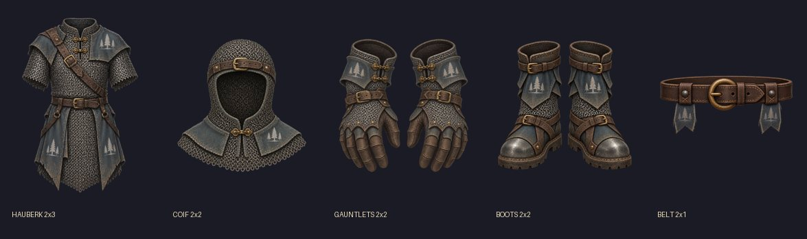

# Greyfen Warden — Mail armor review

Five original Higgsfield GPT Image 2.6 armor images created under the user's **unlimited entitlement** with **zero paid credits**. The Greyfen Mail art distinctively uses believable chain links, weathered slate blue textile, dark brown leather and brass hardware.

| Item | Grid footprint | Texture size |
|---|---:|---:|
| Hauberk / chest | 2 × 3 | 256 × 384 |
| Coif / head | 2 × 2 | 256 × 256 |
| Gauntlets / hands | 2 × 2 | 256 × 256 |
| Mail boots | 2 × 2 | 256 × 256 |
| Warden warbelt | 2 × 1 | 256 × 128 |

Five lightweight transparent indexed PNG previews, contact sheet and source manifest are stored here. The exact source Higgsfield PNGs and the **nonquantized RGBA masters** are archived in confirmed Higgsfield Developer Files ZIP `4ac609c5-bd5a-473d-8297-13a320fe0d68` (8,679,972 bytes).

25 static source/export checks passed, including presence, transparency, exact 128px/cell geometry and gutters. Previous warbelt generation failed; the successful regenerated warbelt job is linked in source manifest. **No Godot runtime, mouse-driven stash/merchant, or 32px/64px legibility test has yet run** for these new files. No gameplay files, saves, item definitions or original validated build were modified.
