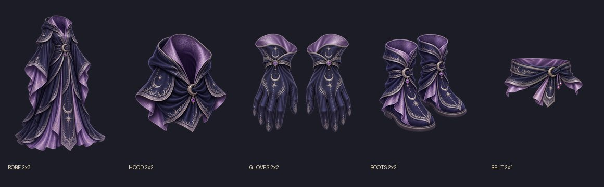

# Moonweave Arcanist — Cloth armor review

Five ORIGINAL Higgsfield GPT Image 2.6 items; **unlimited allowance only, zero paid credits**. Created to match the painterly AOTL anime-fantasy visual canon with indigo/lilac cloth, restrained lunar sigils and antique silver trim.

| Item | Inventory cells | Transparent pixels |
|---|---:|---:|
| Robe / chest | 2 × 3 | 256 × 384 |
| Hood | 2 × 2 | 256 × 256 |
| Gloves | 2 × 2 | 256 × 256 |
| Boots | 2 × 2 | 256 × 256 |
| Sash / belt | 2 × 1 | 256 × 128 |

Compact RGBA-capable PNG exports in `runtime_items/` are **review files** at 128px per cell. The full-size original Higgsfield PNG source images and unquantized alpha exports (and complete SHA-256 source records) are preserved in the confirmed **Higgsfield Developer Files ZIP archive**, media ID `74be697f-3ef2-4fbb-b790-5f965a83a3de` (8,146,337 bytes).

**25/25 initial static checks passed:** file presence, transparent source, exact geometry, alpha gutters, readable compact alpha. **Actual Godot runtime and small-size 32px legibility are not yet tested.** All assets remain candidate art; no new loot templates, save/schema changes or gameplay integration. Do not replace the validated playable project.
