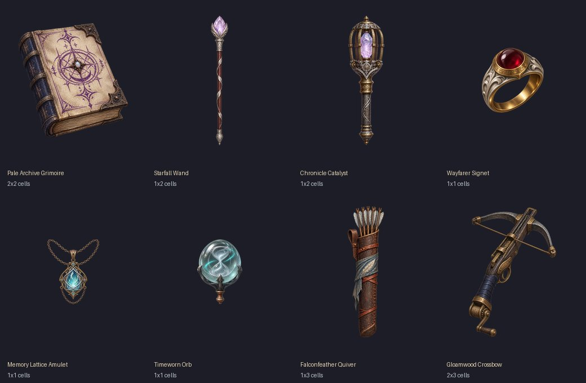

# AOTL — Phase A Relic Implements, Jewelry and Ranged Art

Eight **original Higgsfield GPT Image 2.6** equipment art candidates, generated using **unlimited entitlement only** with **zero paid credits**. Each item has a preserved source job ID/URL and SHA-256 in `SOURCE_MANIFEST.json`.

| Artwork | Grid size | Type |
|---|---:|---|
| Pale Archive Grimoire | 2×2 | Caster off-hand |
| Starfall Wand | 1×2 | One-hand magic weapon |
| Chronicle Catalyst | 1×2 | Caster focus |
| Wayfarer Signet | 1×1 | Ring |
| Memory-Lattice Amulet | 1×1 | Amulet |
| Timeworn Orb | 1×1 | Caster off-hand focus |
| Falconfeather Ranger Quiver | 1×3 | Ranged off-hand |
| Gloamwood Repeater Crossbow | 2×3 | Ranged weapon |

The `runtime_items/` files are **compact transparent review previews** at 128px per inventory cell. Their corresponding **full-resolution original Higgsfield source PNGs**, unquantized RGBA masters, metadata, and full contact sheet are preserved in the confirmed Higgsfield Developer Files archive:
- Media ID `77948267-3972-40b5-8985-67fa85d2aec5`
- Archive `AOTL_PhaseA_Relic_Implements_8_Originals_and_RGBA_2026-11-12.zip` (10,001,327 bytes, 29 files)
- **56/56 raw source/alpha/gutter/dimension checks passed**, and archive ZIP integrity passed.

This is an **art-review branch only**. The source code, save schema, character classes, loot tables, approved gameplay balance, inventory slot definitions and current playable Godot build are unchanged. Do not add gameplay definitions for these candidate variant artworks until tested. Source images are not yet inspected at actual 32px/64px or tested for inventory/stash/merchant/drag/save-load regressions in Godot. See `validate_relic_implements.py` for local static checks.

The visual direction: crisp isolated painterly fantasy objects, truthful craft materials, substantial silhouettes rather than repeated ornamental sprites. This batch intentionally expands variants beyond generic swords and armor.
