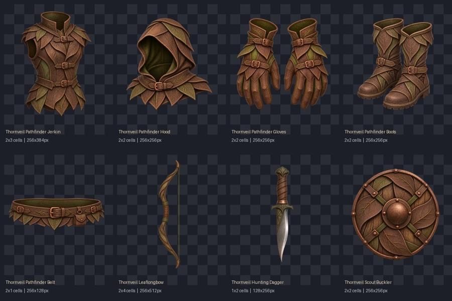

# AOTL Phase A — Thornveil Pathfinder equipment review pack

**Eight new original, coordinated painterly fantasy equipment designs**, created in Higgsfield GPT Image 2.6 with the user's *unlimited entitlement only*, no paid credits.

The **Thornveil Pathfinder** visual identity deliberately contrasts with the Chronicle Guard plate set: russet bark-tanned leather, muted moss-green woven panels, leaf-shaped reinforcements, and worn copper buckles. All images are standalone inventory objects with real alpha transparency.

| Design | W × H inventory cells | Export size |
|---|---:|---:|
| Leather ranger jerkin | 2×3 | 256×384 |
| Scout hood | 2×2 | 256×256 |
| Leather gloves (pair) | 2×2 | 256×256 |
| Ranger boots (pair) | 2×2 | 256×256 |
| Leather belt | 2×1 | 256×128 |
| Leaflongbow | 2×4 | 256×512 |
| Hunting dagger | 1×2 | 128×256 |
| Scout buckler | 2×2 | 256×256 |

The eight **compact indexed PNGs** in `runtime_items/` are prepared for inexpensive browser/Godot art review. Their full-quality **RGBA masters and untouched Higgsfield original PNGs**, the full 1080×720 contact sheet and exact source hashes are preserved in the Higgsfield Developer Files archive (media ID `2f598d2d-39bd-40a5-8964-c96f6de7b6e4`, ZIP 12,075,033 bytes). Source links and original PNG hashes are documented in `SOURCE_MANIFEST.json`.

Validation: 48/48 static source, size, alpha, gutter and checksum checks pass for the unquantized masters; a separate Python verifier is supplied for this branch's compact art files. Visual inspection of the contact sheet shows coherent item design. **Engine-run inventory/readability testing is still pending**.

No gameplay changes, new item templates, balancing effects, loot tables, or save migration. The production-tested Crownsfall LootSlice baseline remains unchanged.

## Review / integration checklist

1. Open the contact sheet above and compare silhouette clarity and set identity.
2. Run `python validate_thornveil.py` after installing Pillow.
3. Preview 32px and 64px item scales, especially longbow and dagger; inspect transparent fringes.
4. When approved, use the full RGBA masters—not the compact review PNGs—on an isolated Godot art test branch, preserving the item's authoritative inventory footprint.
5. Check both player classes, character screen, 10×6 backpack grid, stash, merchant, drag/overlap, tooltips and save/load.
6. Merge this draft artwork PR separately only after review.

This is **Phase A art candidate delivery**, not all of Phase A gameplay integration.
