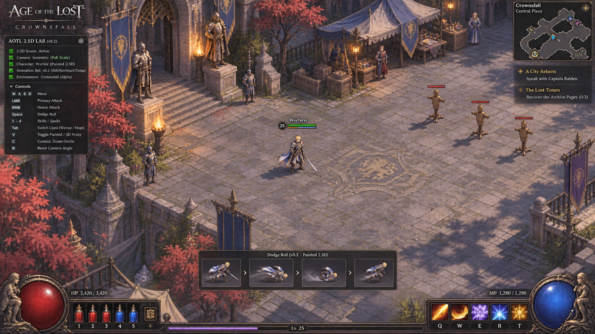

# AOTL target UI layout and camera distance

**Status: owner-supplied direction, November 12, 2026.** The project owner provided this image as the new UI layout and format and the new camera distance going forward. The camera distance is variable: the mouse scroll wheel zooms in and out.

`aotl_ui_camera_target.png` — 1672x941 RGBA PNG, SHA-256 `7433aff1801d86430a2b42126548394bf98acb62a6b40a37d27bc47e60352200`. Stored as a normal Git file (not Git LFS) so it can be read directly. It is a reference mockup, not an engine capture, and is not a runtime asset.

## What the owner stated

- This is the new UI layout and format.
- This is the new camera distance, zoomable in and out with the mouse scroll wheel.
- Other AI agents should use it for camera distance and UI layout going forward.

## What the image shows

The points below are read from the image. Where they differ from the current game they are a target to confirm with the owner, not a decision already made.

**Camera**

- High isometric view of the Crownsfall plaza at a wide, Path of Exile-like scale.
- The character is small on screen: roughly 110 px tall in a 941 px tall frame, about 12% of screen height, standing near the centre.
- A large area of the plaza is visible at once: stairs and statues, the market stalls, the floor crest and three training dummies.

**HUD layout**

- Top left: game logo ("Age of the Lost — Crownsfall").
- Left, under the logo: a collapsible lab/debug panel with status ticks and a Controls list.
- Top right: minimap with zone name ("Crownsfall — Central Plaza"), and a quest tracker directly under it.
- Bottom left corner: red life orb in a sculpted stone frame, with "HP current / max" text beside it.
- Bottom left, right of the life orb: five flask slots labelled 1-5 (three red, two blue), then one extra utility slot.
- Bottom right corner: blue mana orb in a matching frame, with "MP current / max" text beside it.
- Bottom right, left of the mana orb: five square skill slots labelled Q, W, E, R, T.
- Bottom centre: thin experience bar spanning between the two clusters, with the level ("Lv. 25") at its centre.
- Above the character: name plate with level badge and small life/mana bars.
- Above enemies: small red health bars.
- Bottom centre, above the XP bar: a "Dodge Roll (v0.2 - Painted 2.5D)" four-pose preview strip. This reads as a lab preview panel rather than permanent HUD.

**Controls listed in the image's panel**

| Input | Action |
| --- | --- |
| W A S D | Move |
| LMB | Primary Attack |
| RMB | Heavy Attack |
| Space | Dodge Roll |
| 1 - 4 | Skills / Spells |
| Tab | Switch Class (Warrior / Mage) |
| V | Toggle Painted / 3D Proxy |
| C | Camera: Zoom Out/In |
| R | Reset Camera Angle |

## Open points for whoever implements this

- The Controls panel says skills are on 1-4, but the HUD shows flasks on 1-5 and skills on Q W E R T. These conflict; confirm the intended bindings before changing input.
- The owner asked for scroll-wheel zoom; the panel lists C for zoom. Treat scroll wheel as the requirement.
- The playable project on `main` (`game/crownsfall_lootslice`) currently uses click-to-move, skills on RMB/1-4 and potion on Q. Moving to this layout changes input, HUD and camera together.
- The plaza art and autumn palette in the image differ from the current painted plaza; this file is filed as a camera and UI reference only.
