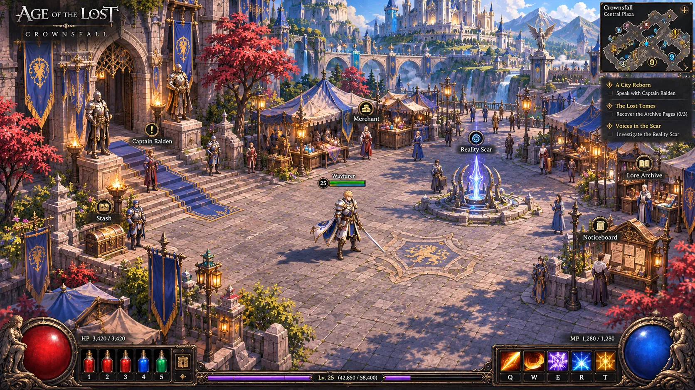

# AOTL UI target v2 (owner-locked, 2026-11-19)

**Status:** the project owner supplied this image on 2026-11-19 with the instruction:
*"Make sure the UI looks like this, with the HP and mana globes to the side with the artwork on them. Potion bar and skill bar, XP bar in the middle."*
This **supersedes the HUD layout** in `../2026-11-12/` (which also had a lab/debug panel). The camera distance from 2026-11-12 still applies.

`aotl_ui_target_v2.png` — 1672×941 RGB, SHA-256 `aa2385c41b06bb087aa917e5b21bd29e107564a49cdfcfa86b829f3731cc52dc`. Reference mock-up, not a runtime asset. Stored as a normal Git file so agents can read it directly.

## HUD layout (read from the image)

### Bottom-left cluster
- **Life globe:** large red liquid orb in an ornate bronze/gold filigree ring frame. A **seated stone maiden statue** is sculpted onto the frame's outer (left) side, leaning against the orb.
- **HP text** above the bar, right of the globe: `HP 3,420 / 3,420`.
- **Flask bar** to the right of the globe: dark recessed panel with gold trim, **5 flask slots** labelled 1–5 on small plates beneath. Shown: red, red, red (life), blue (mana), green (utility).
- **Utility slot** at the end of the flask bar: square slot with a map/tome icon and a small sub-button below it.

### Bottom-centre
- **XP bar** spanning between the two clusters: thin purple fill in an ornate dark-metal frame with segment ticks.
- Centred label: `Lv. 25 (42,850 / 58,400)`.

### Bottom-right cluster (mirror of the left)
- **Skill bar** left of the mana globe: **5 square skill slots Q W E R T** with key plates beneath. Example icons: flaming sword slash, fire ring, arcane star, frost burst, holy sun.
- **MP text** above the bar: `MP 1,280 / 1,280`.
- **Mana globe:** blue liquid orb in the matching frame, with the **seated stone maiden statue mirrored** onto the outer (right) side.

### Top
- **Top-left:** game logo, "AGE OF THE LOST" over a line and "CROWNSFALL" in spaced caps, silver serif.
- **Top-right:** square **minimap** with bronze frame, zone title "Crownsfall / Central Plaza" and a `+` button; coloured POI icons.
- **Quest tracker** under the minimap: gold diamond bullets, quest title in gold, objective with checkbox in white
  (e.g. *A City Reborn — Speak with Captain Ralden*; *The Lost Tomes — Recover the Archive Pages (0/3)*; *Voices in the Scar — Investigate the Reality Scar*).

### In-world labels
- **Player nameplate:** round level badge (`25`), name `Wayfarer`, green life bar.
- **Service markers:** round dark badges with a gold icon above a white name label: `!` Captain Ralden, coins Merchant, swirl Reality Scar, open book Lore Archive, scroll Noticeboard, chest Stash.
- The lab/debug panel and the dodge-roll preview strip from the 2026-11-12 mock-up are **gone**.

## Art pieces needed (see `docs/art/HIGGSFIELD_3000_CREDIT_PLAN.md`, Phase 5)
Life globe frame + left statue, mana globe frame + right statue, red and blue liquid fills (static + looping animated swirl),
glass highlight overlay, flask bar panel, flask icons (red/blue/green, full/empty), utility slot + map icon, skill bar panel,
key-label plates, XP bar frame + fill + tick overlay, minimap frame, quest tracker backing + diamond bullet, logo,
6 service marker badges, nameplate + level badge.

## Camera: pull back further, Path of Exile style (owner note, 2026-11-19)

The owner asked for the camera to be **a little farther out than this mock-up**, using Path of Exile as the reference.

What PoE does (for whoever implements this):
- **Perspective, not true isometric.** PoE uses a perspective projection, so things farther up the screen are slightly smaller. Use a perspective `Camera3D` with a narrow FOV, not orthographic.
- **Steep pitch.** PoE's camera looks down more steeply than Diablo 2/3 or Titan Quest, so you see the ground all around the character rather than far ahead.
- **Small character.** In PoE gameplay the character is roughly 8–10% of screen height (an estimate from gameplay screenshots).

Targets for AOTL (starting values to tune by eye; not measured from PoE's engine):

| Setting | This mock-up | Target |
|---|---|---|
| Player height on screen | ~17–18% of screen height (~165 px of 941) | **~9–10%** (~95–105 px at 1080p) |
| Visible ground (vertical) | ~15 m | **~26–28 m** (the 2026-11-12 build used 21 m) |
| Camera pitch | ~45° | **50–55° down** |
| Projection | — | perspective, vertical FOV ~30–35° |
| Zoom | — | mouse wheel, ~0.7× to 1.3× around the default; Home/R resets |

Art consequences: at ~100 px tall, actors need bold silhouettes and readable colour blocks (blue/gold cape, weapon shape).
Fine facial detail won't show, which favours the rigged-3D-character route in the credit plan. HUD art is screen-space and unaffected.
