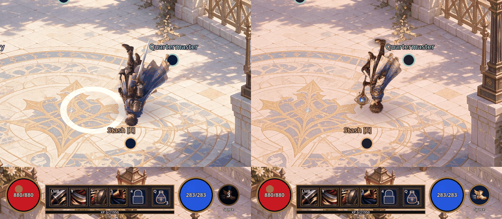

# Dodge Roll — November 12, 2026

[Handoff, behavior and QA](../../../game/crownsfall_lootslice/docs/DODGE_ROLL_HANDOFF.md).

`dodge_roll_preview.png` is cropped from real Godot 4.6.3 captures taken by the rendered run of `tests/dodge_roll_integration.gd` (Linux, Xvfb, software OpenGL, 1920x1080): Warrior and Mage at mid-roll, then the HUD button on cooldown and ready. Colours are reduced to 256 to keep the file small.

The four full-size captures the test writes to `game/crownsfall_lootslice/previews/dodge_roll/` are not committed: this session could not upload Git LFS objects, and every PNG under `game/` is LFS-tracked. For the same reason `assets/ui/dodge_roll.png` (22 KB) is stored as a normal Git file through a one-line `.gitattributes` exception. Re-run the suite without `--headless` to regenerate the captures.
